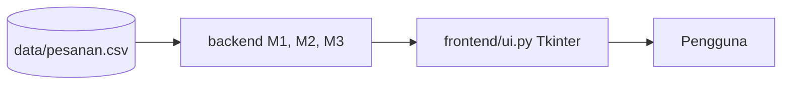

# 2EZ4U APP

Project akhir Struktur Data & Analisa Algoritma (EC234303)

Nama / NRP : Virel Ekana Gardianta
Video demo : **TODO (link video)**

## Deskripsi

Aplikasi mirip GoFood/GrabFood. Isinya engine backend pengelola pesanan (200.000 data)
dan satu jendela Tkinter untuk mencoba semua fitur. Semua struktur data dan algoritma dibuat sendiri
tanpa `dict`, `set`, `sorted`, `.sort()`, `heapq`, `bisect`, dan `collections`. Hanya `list` sebagai array biasa.

Fitur yang sudah selesai:

| Milestone | Isi | File |
|---|---|---|
| M1 | Array vs Linked List (lihat, tambah, hapus pesanan) | `backend/m1_pesanan.py` |
| M2 | Stack (postfix kasir, undo/redo) dan Queue (naif vs melingkar) | `backend/m2_antrean.py` |
| M3 | Sort (insertion, merge) dan Search (linear, binary) | `backend/m3_laporan.py` |

## Diagram



## Cara menjalankan

Butuh Python 3.11+ dan Tkinter (Linux: `sudo apt install python3-tk`).

```bash
git clone TODO-url-repo
cd 2ez4u
python app.py
```

Klik **Load** dulu untuk memuat data, lalu pilih menu di sebelah kiri.

Tes dan benchmark:

```bash
python tests/test_m1.py
python tests/test_m2.py
python tests/test_m3.py
python benchmark/benchmark_m3.py
```

## Screenshot


## M1: Array vs Linked List

Pesanan ada 3 jenis dan masuknya beda tempat: REGULER di belakang, PRIORITAS di tengah, VIP di depan.
Data disimpan di Array dan Linked List sekaligus supaya bisa dibandingkan.

| Operasi | Array | Linked List |
|---|---|---|
| Lihat ke-i | O(1) | O(n) |
| Tambah REGULER | O(1) amortized | O(1) |
| Tambah PRIORITAS | O(n) | O(n) |
| Tambah VIP | O(n) | O(1) |
| Hapus ke-i | O(n) | O(n) |

Array kapasitasnya digandakan kalau penuh, jadi append rata-rata O(1).
Linked List menyimpan `head` dan `tail` supaya tambah di belakang tetap O(1).
Jumlah geseran dan telusuran dihitung dan ditampilkan di UI.

## M2: Stack & Queue

- **Postfix kasir**: infix diubah ke postfix pakai stack operator, lalu dihitung pakai stack angka.
  Saat menghitung, operand kanan di-pop dulu supaya `-` dan `/` benar.
- **Undo/Redo**: dua stack. Aksi baru masuk ke undo dan **mengosongkan redo**.
  Undo DEQUEUE menyimpan daftar pesanannya (bukan cuma jumlahnya) supaya bisa dikembalikan ke depan antrean.
- **Antrean naif**: `dequeue` mengambil indeks 0 lalu menggeser semua sisanya, jadi O(n).
- **Antrean melingkar**: hanya `front` yang maju (`(front+1) % K`), tidak ada yang digeser, jadi O(1).

Catatan keputusan:
- Kosong/penuh dibedakan pakai variabel `count`, karena kalau cuma `front` dan `rear`,
  kosong dan penuh sama-sama `front == rear`.
- Kalau antrean penuh, kapasitas **tumbuh 2x** (tidak menolak).
- `dequeue` saat kosong mengembalikan `None`.

## M3: Sort & Search

| Algoritma | Kompleksitas | Catatan |
|---|---|---|
| Insertion sort | O(n²) | stabil, dibatasi 20.000 baris |
| Merge sort | O(n log n) | stabil, untuk data besar |
| Linear search | O(n) | data boleh acak |
| Binary search | O(log n) | data harus terurut menurut oid |

- Setiap menu menampilkan **jumlah perbandingan**, bukan hanya waktu.
- Stabil: insertion sort pakai `>` (bukan `>=`), merge sort pakai `<=` (bukan `<`).
- Binary search butuh daftar terurut oid. Daftar ini dibangun sekali pakai merge sort,
  waktunya ditampilkan, dan dibangun ulang kalau data M1 berubah.
- Insertion sort menolak data lebih dari 20.000 baris dengan pesan, jadi aplikasi tidak hang.

**Kenapa pilih algoritma ini**
- Insertion sort: sederhana, bagus untuk data kecil/hampir terurut, jadi pembanding.
- Merge sort: selalu O(n log n) dan stabil, cocok untuk 200.000 data.
- Linear search: dipakai kalau cari sekali dua kali, karena mengurutkan dulu lebih mahal.
- Binary search: dipakai kalau cari berkali-kali karena tiap cari cuma sekitar 17 perbandingan.

**Tabel n vs perbandingan** (`)


Kalau n dilipatduakan, perbandingan insertion sort naik sekitar 4x, merge sort sekitar 2x.


**Linear vs binary** (cari oid yang sama)

| | perbandingan |
|---|---:|
| Linear search | TODO |
| Binary search | TODO |

## Catatan penting

- Dequeue naif dan melingkar dijalankan terpisah, jadi panjang kedua antrean bisa beda setelah dequeue.
  Memang disengaja supaya selisihnya kelihatan.
- Yang dinilai adalah pola dan jumlah perbandingan, bukan angka waktu karena tergantung komputer.
- M4 sampai M6 belum dikerjakan.
